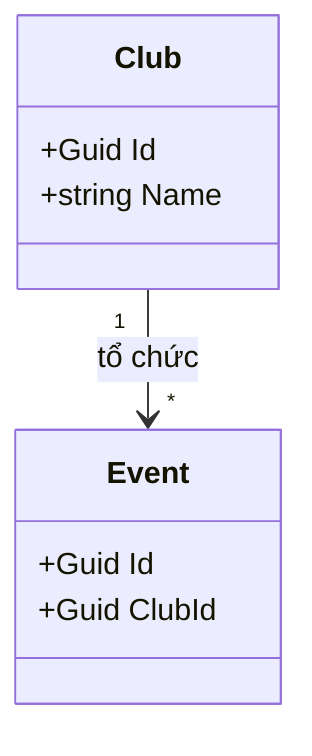

Vẽ bằng Mermaid (hiển thị trực tiếp trên GitHub) hoặc xuất ảnh từ draw.io rồi đặt cạnh file này.
Ghi rõ thuộc tính chính, khoá ngoại (FK) và bội số quan hệ (1, *, 0..1).

classDiagram
    class Member {
        +Guid Id
        +string Name
        +string Email
        +string StudentCode
        +DateTime JoinedAt
        +Create(name, email, studentCode) Member
        +IsActive() bool
    }

    class Club {
        +Guid Id
        +string Name
        +string Description
        +DateTime CreatedAt
        +IReadOnlyList~Member~ Members
        +Create(name, description) Club
        +AddMember(member) void
        +MemberCount() int
    }

    class Event {
        +Guid Id
        +Guid ClubId
        +string Title
        +DateTime Date
        +int Capacity
        +bool IsOnline
        +Create(clubId, title, date, capacity, isOnline) Event
        +HasCapacity(registeredCount) bool
    }

    class Registration {
        +Guid Id
        +Guid MemberId
        +Guid EventId
        +DateTime RegisteredAt
        +string Status
        +Create(memberId, eventId) Registration
        +Confirm() void
        +Cancel() void
    }

    class CheckIn {
        +Guid Id
        +Guid RegistrationId
        +DateTime CheckedInAt
        +string Method
        +Create(registration, method) CheckIn
        +Summary() string
    }

    Club "1" -- "0..*" Member : FK_ClubId
    Club "1" -- "0..*" Event : FK_ClubId
    Member "1" -- "0..*" Registration : FK_MemberId
    Event "1" -- "0..*" Registration : FK_EventId
    Registration "1" -- "0..1" CheckIn : FK_RegistrationId